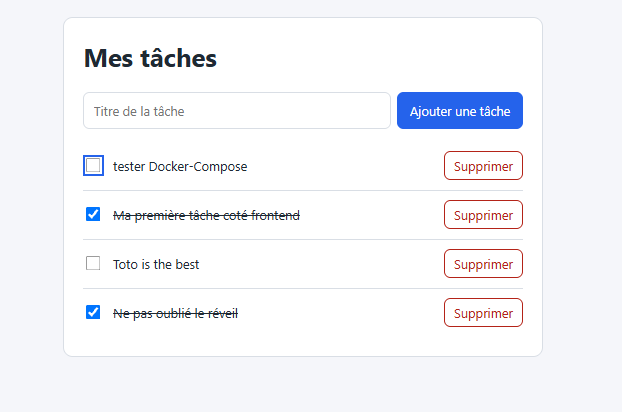

# micro-api

Une application de gestion de tâches composée d'une API REST, d'une base de données PostgreSQL et d'une interface web en JavaScript.

Ce projet me permet de mettre en pratique une chaîne de développement complète : conception d'une API, persistance des données, conteneurisation, tests automatisés et intégration continue.



## Technologies

Python 3.13, FastAPI, SQLAlchemy, PostgreSQL 18, Docker, Docker Compose, pytest, GitHub Actions, HTML, CSS et JavaScript.

## Lancer le projet

### Prérequis

- Git
- Docker avec Docker Compose
- Python 3.13 (pour les tests et le frontend)

### Installation

```bash
git clone git@github.com:Heraclesnyx/micro-api.git
cd micro-api
cp .env.example .env
```

Ouvrir le fichier `.env` et remplacer les valeurs `change_me` par ses propres paramètres de base de données.

La variable `DATABASE_URL` présent dans `.env.example` est uniquement utilisée pour lancer l'API directement hors Docker. Avec Docker Compose, l'URL de connexion de l'API est construite à partir des variables d'environnement du service et utilise `db` comme nom d'hôte PostgreSQL.

Démarrer les conteneurs :

```bash
docker compose up -d --build
docker compose ps
```

Attendre que les services soient opérationnels (`healthy`).

L'API est disponible à l'adresse :

- API : http://127.0.0.1:8000
- Documentation interactive : http://127.0.0.1:8000/docs

### Lancer le frontend

Dans un second terminal :

```bash
cd frontend
python -m http.server 5500
```

Ouvrir ensuite http://127.0.0.1:5500 dans un navigateur.

### Arrêter le projet

```bash
docker compose down
```

Pour supprimer également les données persistées de PostgreSQL :

```bash
docker compose down -v
```

**Attention :** cette dernière commande supprime le volume de données de la base.

## Lancer les tests

Créer un environnement virtuel :

```bash
python -m venv .venv
```

Activer l'environnement virtuel :

```bash
# Windows PowerShell
.venv\Scripts\Activate.ps1
```

```bash
# Linux / macOS
source .venv/bin/activate
```

Installer les dépendances de développement et lancer les tests :

```bash
pip install -r requirements-dev.txt
python -m pytest -v
```

Les tests couvrent les principales opérations de l'API : création, lecture, modification et suppression des tâches, ainsi que la validation des données.

Ils utilisent SQLite en mémoire : aucune instance PostgreSQL n'est nécessaire pour les exécuter localement.

## Pipeline CI

GitHub Actions automatise les vérifications du projet.

Le pipeline comprend les étapes suivantes :

1. **tests** : exécute la suite de tests pytest.
2. **docker-build** : vérifie la construction de l'image Docker.
3. **smoke-test** : démarre l'application avec Docker Compose et PostgreSQL, puis vérifie le fonctionnement de l'API (santé, création et lecture d'une tâche).
4. **publish-image** : publie l'image sur GitHub Container Registry (GHCR), uniquement sur la branche `main` et après réussite des vérifications requises.

Schéma simplifié :

```text
         tests
        /     \
       v       v
docker-build  smoke-test
       \       /
        v     v
     publish-image
         (main)
```

La publication de l'image ne s'exécute jamais sur un pull request : elle est réservée au push sur `main`

## Décisions de conception

- **SQLite en mémoire pour les tests** : permet d'exécuter rapidement les tests sans dépendre d'une instance PostgreSQL. Le smoke test vérifie séparément le fonctionnement avec PostgreSQL.
- **Utilisateur non-root dans Docker** : l'API s'exécute avec un utilisateur système dédié (`appuser`), sans privilèges administrateur. Les fichiers de l'application restent non modifiables par cet utilisateur.
- **`.env.example` et `.env`** : le fichier d'exemple documente les variables nécessaires, tandis que le fichier contenant les paramètres locaux est exclu du dépôt.
- **CORS** : les requêtes cross-origin depuis un navigateur sont autorisées pour l'origine du frontend (`http://127.0.0.1:5500`).
- **Validation des données** : l'API refuse notamment les titres vides ou composés uniquement d'espaces, lors de la création comme de la modification d'une tâche.

## Limites et améliorations envisagées

- Remplacer `create_all` par des migrations de schéma avec Alembic.
- Ajouter des tests exécutés directement contre PostgreSQL dans la CI.
- Mettre en place un système d'authentification.
- Externaliser la configuration CORS plutôt que de conserver l'origine dans le code.
- Étudier le déploiement de l'application sur Microsoft Azure.

<!-- Test de la protection de la branche main -->
